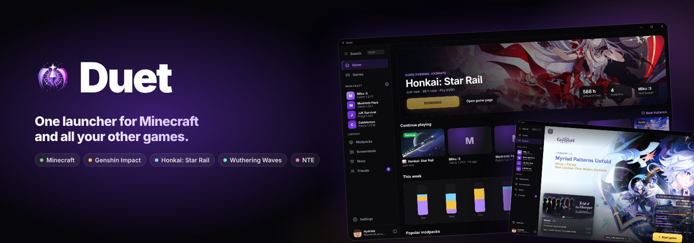
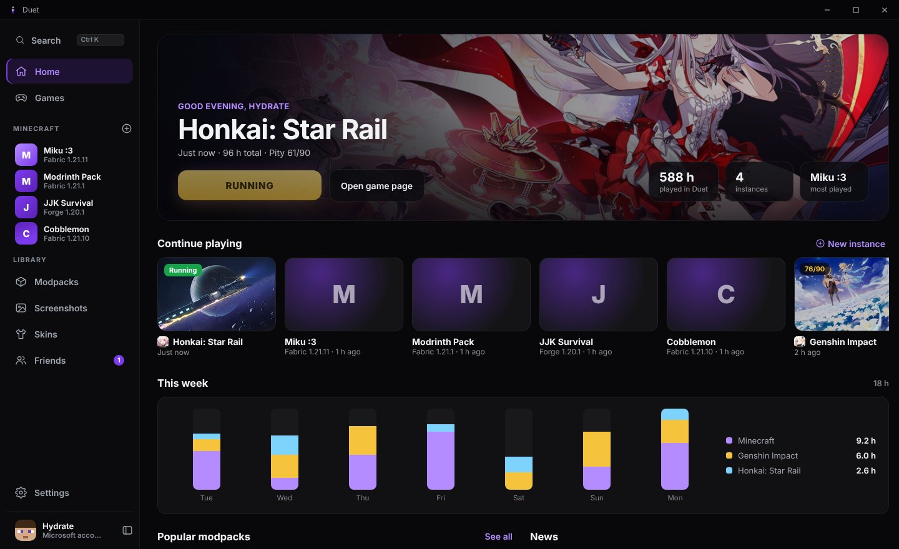
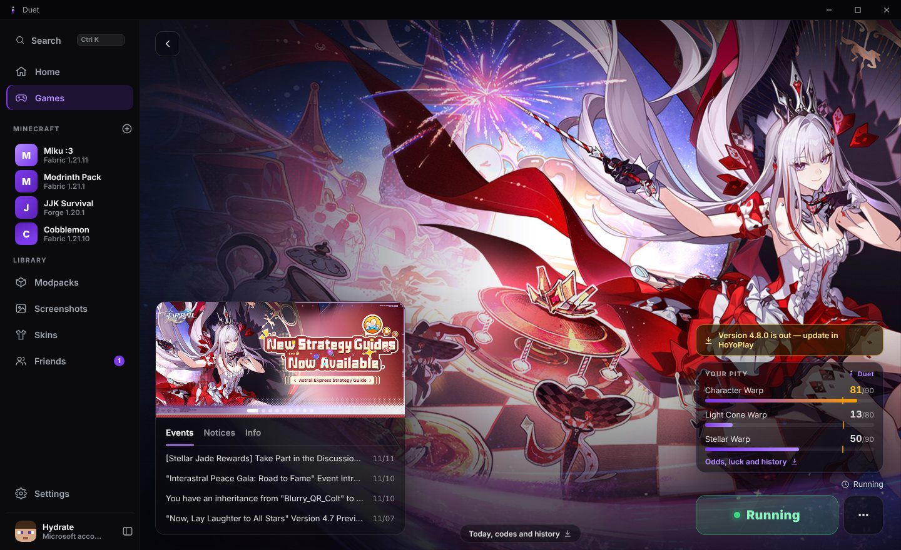
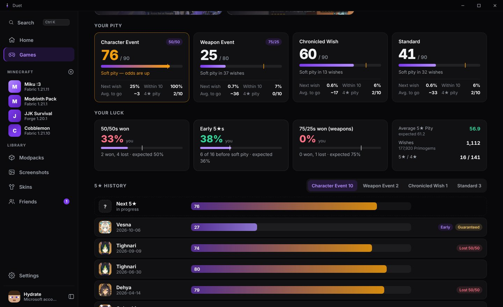
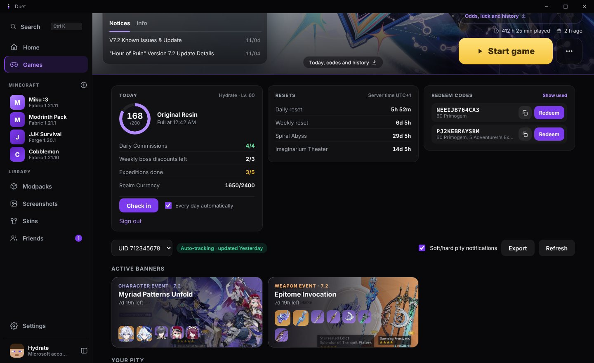
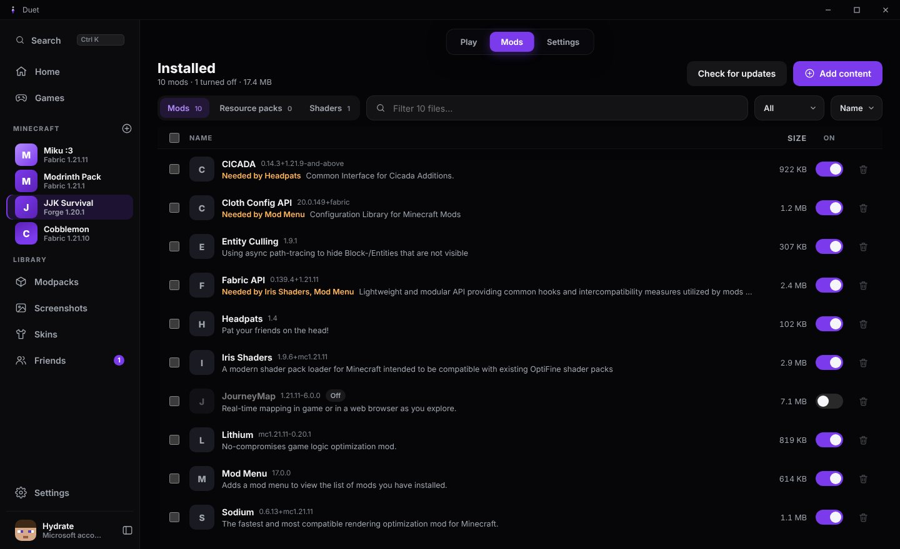
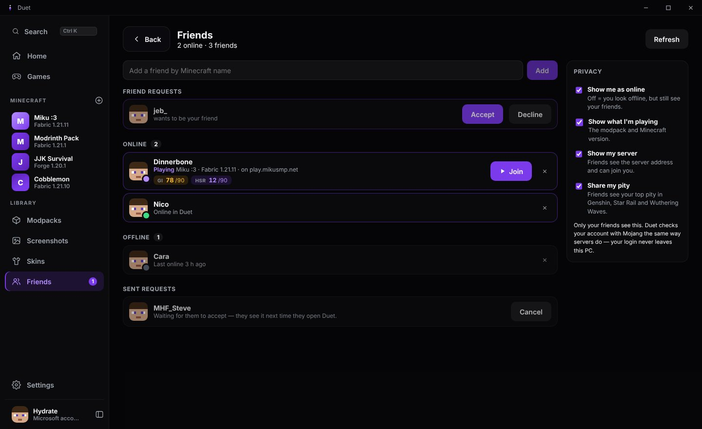

  

  
  
  

<h3 align="center">One launcher. All your games.</h3>

  Minecraft with one-click modpacks and more FPS — plus <b>Genshin Impact</b>, <b>Honkai: Star Rail</b>, <b>Wuthering Waves</b> and <b>Neverness to Everness</b>, 
  with pity tracking, Resin, daily check-in and redeem codes in one place.

  <a href="https://github.com/Hydrate36/duet/releases/latest"><b>⬇ Download</b></a> &nbsp;·&nbsp;
  <a href="https://hydrate36.github.io/duet/">Website</a> &nbsp;·&nbsp;
  <a href="#-new-in-12">What's new</a> &nbsp;·&nbsp;
  <a href="#-faq">FAQ</a>

 

  

## ✨ New in 1.2

### 🎮 Games tab
Duet finds your games through HoYoPlay and Steam and gives each one a page that looks like its own launcher — the current key art, the official news, a big **Start game** button — with Duet's extras on top.

  

| | Genshin Impact | Honkai: Star Rail | Wuthering Waves | NTE |
| --- | :---: | :---: | :---: | :---: |
| Game page, Start, playtime | ✅ | ✅ | ✅ | ✅ |
| Install button when missing | ✅ | ✅ | ✅ | ✅ |
| Pity tracking & 50/50 odds | ✅ | ✅ | beta | — |
| Resin / Trailblaze Power, check-in | ✅ | ✅ | — | — |
| Redeem codes, reset timers | ✅ | ✅ | — | — |
| Update & pre-download notices | ✅ | ✅ | Steam | Steam |

### 📈 Pity tracking
Your wish and warp history is read by itself whenever you open it in game — no links to paste.

- Pity for every banner, with **soft and hard pity alerts**
- Your 50/50 record, luck, and odds for the next pulls
- Active banners and 5★ history
- **Export to UIGF** for any other tracker

  

### ☀️ Today
Sign in to HoYoLAB on **HoYoLAB's own page** (Duet never sees your password) and see what's waiting:

- **Resin / Trailblaze Power** and when it's full, dailies, weekly bosses, expeditions
- **Daily check-in**, every day automatically
- **Reset timers** — daily, weekly, Spiral Abyss and Imaginarium Theater, in your server's time
- **Redeem codes** with their rewards, one click to redeem

  

### 🧹 A cleaner Duet
- **Labeled sidebar** and **Play / Mods / Settings** tabs on every modpack
- **One Home for everything** — what you played last, Minecraft and games mixed, and a **weekly playtime chart**
- **Ctrl + K** — jump to any modpack, game or page
- **A real Mods tab** — names, icons and versions from Modrinth; turn mods on/off, update all, or **delete to the Recycle Bin** with a warning when another mod still needs one
- **Pity with friends** — see your friends' pity next to their name (you can turn it off)
- **Discord status** for your games, and game screenshots in the gallery

  
  &nbsp;
  

## ⛏️ Minecraft

### Play anything
- **Every mod loader**: Fabric, Quilt, Forge and NeoForge, from the newest Minecraft to classics like 1.12.2. Duet installs the loader and the right Java for you.
- **Modpacks in one click**: browse Modrinth's modpacks or drop in an `.mrpack` file. Minecraft, the loader, every mod and its configs are set up automatically.
- **Mods, resource packs and shaders**: search Modrinth, install with dependencies, and update everything with one button.
- **Bring your stuff**: copies instances from the Modrinth App, Dawn (Feather), Prism, MultiMC, CurseForge, ATLauncher, GDLauncher and the official launcher — worlds, mods, packs, settings and servers. It asks first and never touches the other launcher's files.

### Built for FPS
- **Tuned Java profiles**: Smooth (generational ZGC for frame times without spikes), Max FPS (tuned G1) or Low RAM.
- **Built-in speed mods**: Sodium, Lithium, FerriteCore, ImmediatelyFast, EntityCulling, MoreCulling, BadOptimizations, Exordium, Dynamic FPS and Iris load automatically on Fabric and Quilt. Your mods folder stays untouched.
- **NVIDIA turbo**: on RTX and GTX 16 cards, Nvidium draws terrain with mesh shaders for much higher FPS at long render distances.
- **FPS check**: shows which mods and video settings cost the most FPS, with one click to turn a mod off.
- **Far view**: 50+ chunk render distance with Voxy or Distant Horizons, one toggle.

### Duet Mods
A built-in PvP and HUD mod set for Fabric 1.21.11: hit sounds, reach and combo display, CPS, W-tap trainer, custom crosshair with cooldown ring, shield timer, damage numbers, totem pops, kill banners, armor and inventory HUD, and more.

### Make it yours
- **Themes**: seven colour themes, plus seasonal ones for Halloween, Christmas, New Year, Valentine's, Easter and Miku's birthday.
- **Backgrounds**: your newest screenshot, any image, GIF or looping video, with optional sound or your own music.
- **Skin changer**: a 3D preview, a skin library, copying any player's skin and switching capes.
- **Friends**: see who's online and join their server with one click.

  
  &nbsp;
  

## ⬇️ Download

| System | File | Updates |
| --- | --- | --- |
| **Windows 10 / 11** | `Duet_x.y.z_x64-setup.exe` | Automatic |
| **Linux** (any distro) | `Duet_x.y.z_amd64.AppImage` | Automatic |
| **Ubuntu / Debian / Mint** | `Duet_x.y.z_amd64.deb` | Download new versions from the releases page |

Get them from the **[latest release](https://github.com/Hydrate36/duet/releases/latest)**. Once installed, Duet updates itself. The Games tab is Windows-only for now (that's where the games run).

## 🔒 Your accounts are safe

- **Minecraft**: you sign in on **Microsoft's own page**. Your tokens stay on your PC and only go to Microsoft and Mojang.
- **HoYoLAB**: you sign in on **HoYoLAB's own page**. Duet only uses it for Resin, dailies and the check-in, and never solves captchas for you — if one appears, Duet opens the official page.
> **Status:** Microsoft sign-in is waiting for Mojang's approval for third-party launchers. Until then you can set everything up (instances, mods, modpacks, skins); playing Minecraft unlocks once the approval comes through. Your other games aren't affected.

- **Your games**: Duet never changes game files or game memory. It starts games like HoYoPlay or Steam do, and reads pull history through the same official link the game opens.

## ❓ FAQ

<b>Can Duet get my game account banned?</b>

 
Duet doesn't modify games or their memory — it starts them, reads your history through the official link, and talks to HoYoLAB like its website does. That's the same way other popular pity trackers work. Duet also has no FPS unlocker on purpose.

<b>Windows says "Windows protected your PC"</b>

 
Duet isn't code-signed yet, so Windows SmartScreen warns about it. Click <b>More info → Run anyway</b>. Official downloads are only published on this page.

<b>My game isn't found</b>

 
Open the game's page in Games and use <b>Pick folder…</b> (or "Already installed? Pick its folder"). Duet looks in HoYoPlay, Steam and Windows' list of installed programs.

<b>Resin shows an error</b>

 
Turn on <b>Real-Time Notes</b> in your HoYoLAB Battle Chronicle settings, then press Refresh.

<b>Where does Duet keep its files?</b>

 
Windows: <code>%APPDATA%\Duet</code> · Linux: <code>~/.local/share/Duet</code>. Imported instances are copied into this folder; the other launcher keeps its own files.

<b>A video background doesn't play on Linux</b>

 
Linux plays videos through GStreamer. Use a <code>.webm</code> video, or install the codecs: <code>sudo apt install gstreamer1.0-libav gstreamer1.0-plugins-good</code> (Ubuntu and Debian) or <code>gst-libav</code> (Arch). The <code>.deb</code> installs them automatically.

## 🛠️ Built with

[Tauri](https://tauri.app) and Rust · React · [Modrinth API](https://docs.modrinth.com) · [FabricMC](https://fabricmc.net), [Quilt](https://quiltmc.org), [Forge](https://minecraftforge.net), [NeoForge](https://neoforged.net) · [Eclipse Temurin](https://adoptium.net) · [skinview3d](https://github.com/bs-community/skinview3d) · banner data from [paimon.moe](https://paimon.moe) and [samsara](https://github.com/benlei/samsara-web) · icons from [StarRailRes](https://github.com/Mar-7th/StarRailRes) · codes from [hoyo-codes](https://hoyo-codes.seria.moe)

Speed mods are downloaded from Modrinth and belong to their authors.

---

   
  © 2026 Hydrate (Hydrate36). All rights reserved. 
  NOT AN OFFICIAL MINECRAFT PRODUCT. NOT APPROVED BY OR ASSOCIATED WITH MOJANG OR MICROSOFT. 
  Genshin Impact and Honkai: Star Rail are trademarks of COGNOSPHERE (HoYoverse); Wuthering Waves of Kuro Games. Duet is fan-made and not affiliated with or endorsed by them.

